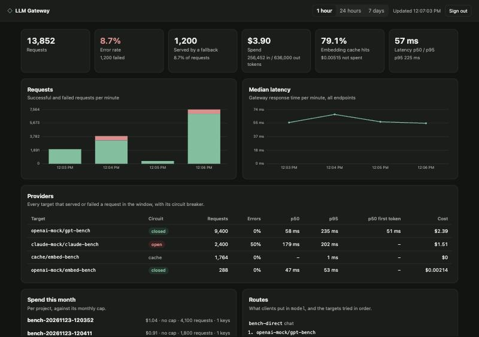
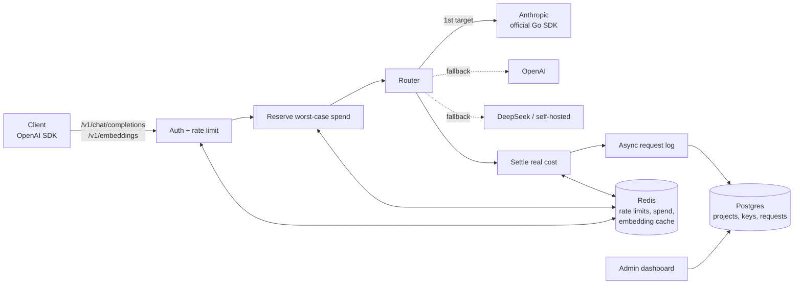

# LLM Gateway

[](https://github.com/kuini-1/llm-gateway/actions/workflows/ci.yml)

A gateway that puts one OpenAI-compatible API in front of Claude, OpenAI, DeepSeek and self-hosted models. It falls back to the next provider when one fails, caches embeddings, enforces monthly spend caps per project and per API key, and logs every request to Postgres. The admin dashboard shows latency, errors, fallbacks and spend.

Written in Go, with PostgreSQL for the request log and Redis for spend counters, rate limits and the embedding cache.



## Highlights

- **Ordered fallback with circuit breakers.** A route such as `smart` lists targets in order. A provider-side failure (5xx, Anthropic's 529, 429, timeouts, bad keys) moves the request to the next target. A bad request does not. After five consecutive failures a target's circuit opens and it is skipped for 30 seconds.
- **Measured overhead:** the gateway adds **7.8 ms at p50 and 10.9 ms at p95** per request at 32 concurrent requests. That includes key lookup, rate limiting, two Redis operations for spend, and logging.
- **Spend caps that hold under concurrency.** Before a call, the worst-case cost is reserved atomically in Redis against both the project's and the key's monthly cap. It is settled to the real cost afterwards. A test fires 200 concurrent $0.01 reservations at a $1 cap: exactly 100 succeed.
- **Embedding cache.** Lookup is by model and exact text, and only the inputs that miss go upstream. On a re-indexing and search workload it served 79% of inputs from cache and cut spend by 71%. Cached embeddings returned in 1.6 ms instead of 48.7 ms.
- **OpenAI-compatible.** Existing OpenAI SDKs work by changing the base URL. Provider, cost, fallback and every attempt are reported in an `x_gateway` field and in response headers.
- **Claude through the official Anthropic Go SDK**, with prompt caching, effort mapping, refusal handling and Anthropic's server-side refusal fallback.

## Quick start (no API keys)

The Compose stack runs Postgres, Redis, the gateway, and two mock providers that speak the Anthropic and OpenAI APIs.

```bash
GATEWAY_ADMIN_TOKEN=change-me docker compose up --build
# Dashboard: http://localhost:8080/admin/   (set GATEWAY_PORT if 8080 is taken)
```

Create a project and a key, then call it like OpenAI:

```bash
curl -s -H "Authorization: Bearer change-me" -d '{"name":"demo","monthly_budget_usd":5}' localhost:8080/admin/api/projects
curl -s -H "Authorization: Bearer change-me" -d '{"project_id":"prj_...","name":"me"}' localhost:8080/admin/api/keys
```

```python
from openai import OpenAI

client = OpenAI(base_url="http://localhost:8080/v1", api_key="gw_...")
reply = client.chat.completions.create(
    model="bench-fallback",  # a route name from the config
    messages=[{"role": "user", "content": "Hello"}],
)
print(reply.choices[0].message.content)
print(reply.model_extra["x_gateway"])  # provider, cost_usd, fallback_from, attempts
```

**Real providers:** copy `gateway.example.yaml` to `gateway.yaml`, set `ANTHROPIC_API_KEY` / `OPENAI_API_KEY` / `DEEPSEEK_API_KEY`, and fill in the prices marked in the file. Then run:

```bash
go run ./cmd/gateway serve -config gateway.yaml
```

## Architecture



## Benchmarks

`gwbench` drives a running gateway against the mock providers, so every number below was measured on a laptop. Full output: [`bench/results/all.md`](bench/results/all.md).

### Overhead

2,000 requests per row, 32 concurrent, against a mock with a fixed 50 ms response time.

| Path | p50 | p95 | p99 | First token p50 | Throughput |
|---|---|---|---|---|---|
| Direct to provider | 52.5 ms | 55.5 ms | 59.6 ms | – | 601 req/s |
| Through the gateway | 60.3 ms | 66.4 ms | 69.6 ms | – | 523 req/s |
| Direct, streaming | 52.8 ms | 58.1 ms | 64.0 ms | 51.5 ms | 593 req/s |
| Gateway, streaming | 57.6 ms | 71.8 ms | 81.0 ms | 55.0 ms | 535 req/s |

Real LLM calls take hundreds of milliseconds to seconds, so 8-11 ms is under 1-2% of a typical request.

### A provider goes down

600 requests per row, 16 concurrent. The primary answers in 150 ± 50 ms, the secondary in 200 ± 50 ms. "Down" means every primary call returns 503.

| Scenario | Succeeded | Served by fallback | p50 | p95 | Calls to the dead primary |
|---|---|---|---|---|---|
| Healthy | 100% | 0 | 182 ms | 204 ms | – |
| Primary down, fallback route | **100%** | 600 | 231 ms | 256 ms | **16 of 600** |
| Primary down, single-target route (circuit open) | 0% | 0 | **5 ms** | 10 ms | 0 of 600 |

With a fallback route, clients see no errors, only the secondary's slightly higher latency. Only 16 calls reached the dead provider: the 5 that opened the circuit plus requests already in flight at 16-way concurrency. After that, the breaker skips the primary. A route with no fallback fails fast with 503 `circuit_open` instead of making every client wait on a dead provider.

### Embedding cache: the savings math

The workload indexes 400 chunks of about 110 words, re-indexes them three times with 10% of chunks edited each pass, then serves 2,000 search queries drawn from 300 distinct ones with a Zipf skew.

| Phase | Inputs | From cache | Paid | Saved |
|---|---|---|---|---|
| Initial index | 400 | 0% | $0.001549 | – |
| 3 re-indexes (10% edited each) | 1,200 | 90% | $0.000458 | $0.004200 |
| 2,000 search queries | 2,000 | 88% | $0.000129 | $0.000945 |
| **Total** | 3,600 | **79%** | **$0.002137** | **$0.005145** |

Spend fell **71%**: $0.0021 instead of $0.0073. The rate is lower than the 79% input hit rate because savings are weighted by tokens: long chunks dominate the token count, and short queries dominate the hits.

In general: **saved = (share of tokens served from cache) × (tokens per month) × (price per token)**. At this workload's 71% and $0.02 per million tokens, a service embedding 1 billion tokens a month saves about $14. With a $0.13-per-million model it's about $92. Embeddings are cheap, so on most workloads **the bigger wins are latency** (1.6 ms for a cached query vs 48.7 ms upstream) and staying under the provider's rate limits. Chat completions are where spend caps matter.

### Real provider latency

`gwbench providers smart fast cheap` compares time to first token and total time per route on real providers. It needs API keys and **has not been run for this README**, so there are no provider comparisons here.

## How failures are handled

| What happened | Example | Next target? | Counts against the circuit? | Client sees (if every target fails) |
|---|---|---|---|---|
| Provider overloaded or down | 500, 502, 503, Anthropic 529, connection refused | yes | yes | 502 `upstream_unavailable` |
| Rate limited by the provider | 429 | yes | yes | 502 |
| Timeout | no response within the provider's timeout | yes | yes | 504 `upstream_timeout` |
| Our key for that provider is wrong | 401, 403 | yes | yes | 502 |
| Model not served by that provider | 404 | yes | yes | 502 |
| The request itself is invalid | 400, 413, 422 | **no** (it would fail everywhere and cost twice) | no | 400 `invalid_request` |
| The model declined (refusal) | Claude `stop_reason: refusal`, OpenAI `content_filter` | only if the route sets `fallback_on_refusal` | no | 422 `refused` |
| Every circuit open | – | – | – | 503 `circuit_open`, immediately |
| Stream fails after the first token | connection reset mid-answer | **no** (the client already has part of an answer) | yes | an `error` event in the stream |

Other decisions:

- **SDK retries are off** (`option.WithMaxRetries(0)`). The gateway decides whether to retry and where. Retrying inside the SDK first would add seconds before failing over.
- **Embedding routes can only fall back to the same model.** Vectors from different models live in different spaces, so mixing them would silently corrupt a vector index. Config validation rejects such routes.
- **Budget refusals return 402, not 429.** OpenAI clients retry 429 automatically, and retrying can't help until the cap is raised.
- **Unpriced models are rejected** unless `allow_unpriced` is set. A model without a price can't be held to a cap.
- **Logging never blocks a request.** Rows are queued and written in batches with `COPY`. If Postgres stalls and the buffer fills, rows are dropped and reported, and requests keep flowing.

## Spend caps

Each request checks two caps: the project's monthly cap and the key's own cap (one key per person or service). A Lua script in Redis does the check and the increment in one step:

1. The script checks every cap: is current spend plus the worst-case cost over the limit? If so, the request is refused, and nothing is held.
2. Otherwise it adds the worst-case cost to every counter. The worst case is all input at full price plus `max_tokens` of output, at the highest-priced target in the route.
3. After the call, the reservation is replaced with the real cost. A failed call releases it.

Counters are per calendar month (UTC). If Redis loses them, they're rebuilt from the Postgres request log on the next request. A cap can be exceeded only by floating-point rounding, never by concurrent requests.

## API

Full spec: [`assets/openapi.yaml`](assets/openapi.yaml), also served at `/openapi.yaml`. A test checks that every documented path is routed.

| Method | Path | |
|---|---|---|
| `POST` | `/v1/chat/completions` | Chat, streaming or not (OpenAI format) |
| `POST` | `/v1/embeddings` | Embeddings with cache |
| `GET` | `/v1/models` | Routes and their targets |
| `GET` | `/admin/api/overview?window=1h\|24h\|7d` | Dashboard data |
| `GET` | `/admin/api/requests?filter=error\|fallback` | Request log |
| `GET` `POST` | `/admin/api/projects` | List and create projects |
| `PATCH` | `/admin/api/projects/{id}` | Change a project's cap |
| `GET` `POST` | `/admin/api/keys` | List and create keys (the secret is shown once) |
| `DELETE` | `/admin/api/keys/{id}` | Revoke a key |
| `GET` | `/healthz`, `/readyz` | Liveness and readiness |

Example response metadata after a fallback:

```json
"x_gateway": {
  "request_id": "req_4c0e9b1f2a3d5e67", "route": "bench-fallback",
  "provider": "openai-mock", "model": "gpt-bench", "cost_usd": 0.00025, "latency_ms": 231,
  "fallback_from": "claude-mock/claude-bench",
  "attempts": [
    {"provider": "claude-mock", "model": "claude-bench", "skipped": true},
    {"provider": "openai-mock", "model": "gpt-bench", "latency_ms": 229}
  ]
}
```

## Tests

```bash
go test ./...                       # unit tests (no services needed)
GATEWAY_TEST_POSTGRES=postgres://... GATEWAY_TEST_REDIS=redis://.../15 go test -p 1 ./...
```

CI runs the full suite against real Postgres and Redis service containers. The integration tests cover:

- chat, fallback and streaming against the mock providers;
- the request log and stats;
- embedding cache hits and misses;
- bad, missing and revoked keys;
- rate limits, spend caps and admin auth.

The router and breaker tests cover every row of the failure table above.

## Configuration

See [`gateway.example.yaml`](gateway.example.yaml). `${ENV}` references are expanded at load time, so keys stay out of the file. Each route lists its targets in fallback order, and every model a route uses needs a price.

## Limitations

- Text chat only. Tool calling, images and `response_format` are rejected with 400 rather than translated.
- Circuit breakers are per gateway instance. With several instances, each opens its own circuit, which is safe but takes a few more failed calls in total.
- If a streaming client disconnects mid-answer, the request is logged with cost 0, because the provider never sends final usage. The provider may still bill for the tokens it generated.
- Prices are configuration. The gateway doesn't fetch them, so they must be kept up to date by hand.
